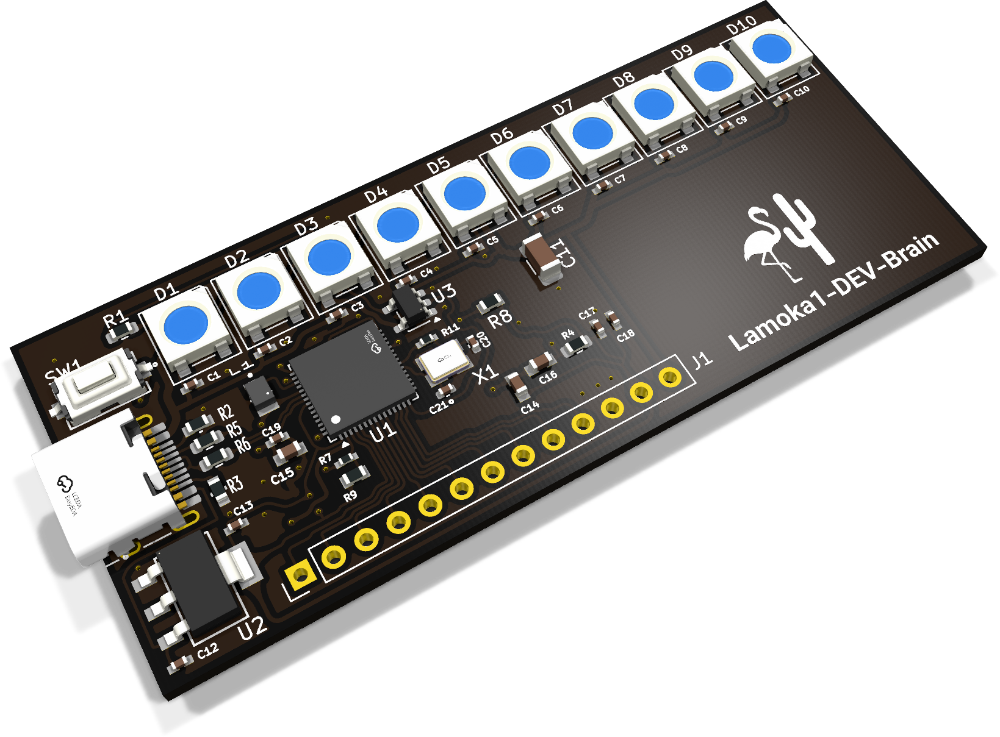
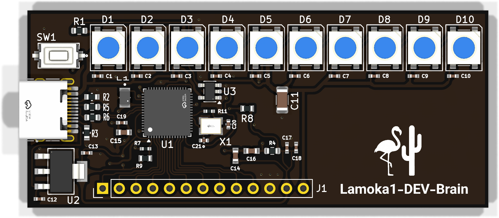

<p align="center">
  
</p>

<p align="center">
  <strong>Lamoka1-DEV-Brain</strong>
</p>

<p align="center">
  This board can now be ordered
  <a href="https://www.pcbway.com/project/shareproject/Lamoka1_DEV_Brain_49e4fd0a.html">here</a>.
</p>

<p align="center">
  PIE versions v1.8 and below will function on this board.
  For more information on PIE, go
  <a href="../SOFTWARE/README.md">here</a>.
</p>

<p align="center">
  <a href="https://htmlpreview.github.io/?https://raw.githubusercontent.com/bearjhartjen/Lamoka1-project/Lamoka1/Lamoka1-DEV-Brain/Kicad%20files/BOM/Lamoka1-DEV-Brain.html">
    <strong>View Interactive BOM</strong>
  </a>
</p>

---

## What this board is

The DEV-Brain brings the Lamoka1's MCU, lights and simplicity into a 70 × 30 mm
laminated sandwich (PCB). It carries the RP2354A microcontroller, one button,
ten addressable RGB LEDs (D1–D10) and a USB-C port.

It is a **prototype of the Lamoka1's control section**, and a product in its own
right — not a throwaway test jig. We develop the PIE firmware on it, because
the control side is where the creativity lives, and because it means we can
work on the lights and the button without ever having the power stage on the
bench.

Flamingo and Cactus have paid PCBWay to manufacture and assemble the DEV-Brain.
It has arrived and works much better than expected. It does, however, make some
high-frequency audible noise when plugged into low-quality power sources, so it
is quite sensitive to low-quality sources.

The main board's interface uses five LEDs (D1–D5) and one button, so the LED
count is a per-board difference to keep in mind when porting firmware.

> [!NOTE]
> The DEV-Brain is a control-only board: it carries no power stage at all.
> PIE V1.8 stays the DEV-Brain head; the Lamoka1/2 runs PIE V1.9.

This board was run through Tomachie to get the design checked; the link is
[here](https://tomachie.com/r/a1f3f256-a8ca-43de-aa92-e70ef981c3c2/Lamoka1-DEV-board_report.html#design-summary).

## How to order one

We have published the board to PCBWay's share projects platform
[here](https://www.pcbway.com/project/shareproject/Lamoka1_DEV_Brain_49e4fd0a.html).
There, you will be able to order the Lamoka1-DEV-Brain exactly as we did.

### 1. Open the shared project

Go to the share-project link above. Everything we used is on that page:

- **Standard PCB** — the project itself
- **Download Gerber file** — the fabrication data
- **BOM (Bill of materials)** — the parts list
- **Centroid file** — the pick-and-place, for assembly

### 2. Choose what you want

| | |
| --- | --- |
| **Only PCB** | Bare boards, you fit the parts yourself |
| **PCB + Assembly** | PCBWay sources and fits the parts for you |

Either way it is the same board: 70 × 30 mm, 2 layers, 1.6 mm FR-4, black
solder mask, white legend, RP2354A, ten WS2812B LEDs, one button.

### 3. Fill in the order form

| Option | Choose |
| --- | --- |
| Base material | FR-4, 1.6 mm, 2 layers |
| Solder mask | **Black** |
| Silkscreen / legend | **White** |
| Surface finish | HASL (or lead-free HASL) |
| Copper | 1 oz / 35 µm |
| Quantity | 5 is a sensible first run |

If you are ordering it assembled, upload the BOM and the centroid file from the
project page — they are the ones we sent, and the
[PCBWay assembly file](<Lamoka1-DEV-Brain fab files/PCBway files/T-1N4W1065266A-1units-Lamoka1-DEV-board+BOM(2026-07-15).xls>)
we used is in the repository.

## How do I get the firmware on it?

The DEV-Brain runs **PIE V1.8**, the bench-tested head. It is built with the
[arduino-pico](https://github.com/earlephilhower/arduino-pico) core and the
[FastLED](https://github.com/FastLED/FastLED) library.

### With the Arduino IDE

1. **File → Preferences → Additional Boards Manager URLs**, and add:
   `https://github.com/earlephilhower/arduino-pico/releases/download/global/package_rp2040_index.json`
2. **Tools → Manage Boards**, search for and install **Raspberry Pi
   Pico/RP2040/RP2350**.
3. **Tools → Manage Libraries**, install **FastLED**.
4. **File → Open**, and open
   [`V1.8.ino`](../SOFTWARE/Portal%20Interface%20Engine/V1.8.ino).
5. **Tools → Board**, pick **Raspberry Pi RP2350**.
6. **Tools → Port**, pick the port that appeared when you plugged the board in.
7. Click **Upload**.

### With the command line

```bash
arduino-cli core install rp2040:rp2040 \
  --additional-urls https://github.com/earlephilhower/arduino-pico/releases/download/global/package_rp2040_index.json
arduino-cli lib install FastLED

make firmware                    # compile the DEV-Brain head (V1.8)
make upload PORT=/dev/ttyACM0    # compile and flash it
```

`make firmware` compiles PIE V1.8 — the DEV-Brain head — by default. To build
the Lamoka1/2 head instead:

```bash
make firmware SKETCH="SOFTWARE/Portal Interface Engine/V1.9.ino"
```

### If the port does not show up

The RP2354A can also come up in USB bootloader mode on its own. In the board's
own UI, go to **Settings → BOOTSEL**. The DEV-Brain has no BOOTSEL button of
its own — you pick it from the menu. The port then reappears as a new device,
and you upload again.

### What you should see

The status ball and the Fireball game, and a button that responds to a tap, a
double-tap and a hold. The gesture guide is in
[`PIE-v1.8-information.md`](../SOFTWARE/Portal%20Interface%20Engine/PIE-v1.8-information.md).

## Project files

- **KiCad source** — the full KiCad 10 project lives in the `Kicad files` folder. Open [Lamoka1-DEV-board.kicad_sch](<Kicad files/Lamoka1-DEV-board.kicad_sch>) for the schematic, [Lamoka1-DEV-board.kicad_pcb](<Kicad files/Lamoka1-DEV-board.kicad_pcb>) for the board layout, and [Lamoka1-DEV-board.kicad_pro](<Kicad files/Lamoka1-DEV-board.kicad_pro>) for the project settings. Symbols and footprints are embedded in the `.kicad_sch` and `.kicad_pcb` files, so the schematic and layout open without extra libraries. 3D models are NOT included: the layout only stores file-path references (`${KIPRJMOD}/components/3dmodels/*.step`), and that folder is excluded from the repo by `.gitignore`. Expect missing 3D bodies in the 3D viewer until you supply your own `.step`/`.wrl` files.
- **Fab files** — everything needed to have the board manufactured yourself is in the `Lamoka1-DEV-Brain fab files` folder: the [bill of materials](<Lamoka1-DEV-Brain fab files/Lamoka1-DEV-board BOM.csv>), the [pick and place file](<Lamoka1-DEV-Brain fab files/Lamoka1-DEV-board Pick and Place.csv>), the [Gerber and drill package](<Lamoka1-DEV-Brain fab files/Lamoka1-DEV-board>), and the [PCBway assembly file](<Lamoka1-DEV-Brain fab files/PCBway files/T-1N4W1065266A-1units-Lamoka1-DEV-board+BOM(2026-07-15).xls>) we sent when we ordered our own boards.
- **3D model** — [Lamoka1-DEV-Brain.step](../HARDWARE/Mechanical/Lamoka1-DEV-Brain.step) is the board exported from the layout (outline, holes, and component bodies) for enclosure and fit checks.

<p align="center">
  
  
  <br><em>3D renders of the laid-out board — exported with <code>kicad-cli pcb render</code>.</em>
</p>

## Tests

We were able to run the Lamoka1-DEV-Brain for 72 hours running the idle blue dot bouncing animation seen in [PIE v1.8](<../SOFTWARE/Portal Interface Engine/V1.8.ino>). The environment was an average of 70 degrees Fahrenheit, and an average humidity of 70 percent. We stopped the test early (there were no signs of issues) because we needed to use the Lamoka1-DEV-Brain to test the HTML file creation concept for getting diagnostic data on the Lamoka1.
