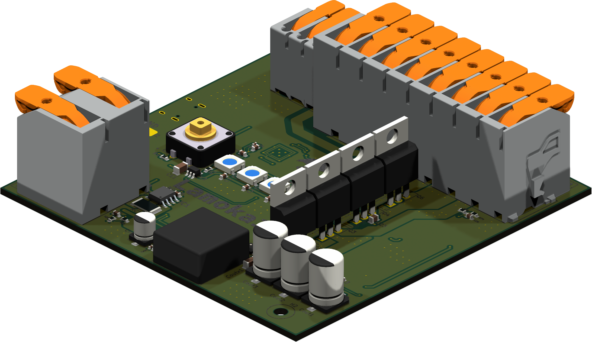

<div align="center">



</div>

# Lamoka1

The Lamoka1 is an open-source inverter: it takes 11–14 V DC from a battery and
turns it into 120 V AC, the kind of power you get from a wall outlet. A
charging section is planned, but it is not built yet — today the project is the
inverter, and that is what we are showing.

It's not just about being open source though. It's also about being intuitive,
accessible, and effective. Everything about it is open: the circuit board
files, the firmware, and the documentation. You can build one, repair it, or
change it however you like, and nothing about how it works is hidden. If you
don't have technical experience, that's completely fine — the stock firmware
gives you a full, working interface, and you only go under the hood if you
want to.

Too many people in this world are trapped by closed, concealed innovation.
With the Lamoka1, we want to smash that barrier down, and put the control of
power back in the hands of the person using it. Flamingo and Cactus is behind
the project, and we built it with very limited resources — that has not held
us back from building, and it will not.
## Project status

| Board | What it is | Where it stands |
| --- | --- | --- |
| **Lamoka1/2** (the main board) | The full inverter — battery power in, 105 V AC nominal out (120 V design target) | Designed and laid out; the power stage has never been powered up |
| **Lamoka1-DEV-Brain** (the control board) | The microcontroller, button, and LEDs, on a small board for firmware development | Built, assembled, and bench-tested — a 72-hour burn-in passed |

The Lamoka1/2 is what Flamingo and Cactus are showing at the Owego Rotary craft
fair: Elks Lodge, Owego, NY, November 14, 9am–3pm.

## Specifications

| | |
| --- | --- |
| **Input** | 11–14 V DC (a 12 V battery) |
| **Output** | 105 V AC nominal, inferred (about 96–105 V at the outlet depending on load); 120 V is the design target and needs the Rev C changes |
| **How it works** | A boost converter raises the battery voltage to 17 V, an H-bridge switches that into an AC waveform, and a transformer steps it up to 105 V nominal (120 V design target) |
| **Brain** | An RP2354A (Raspberry Pi) microcontroller |
| **Transformer** | VPT24-4170, 100 VA, mounted off the board and wired to it |
| **Interface** | One button and addressable RGB LEDs — five on the main board, ten on the DEV-Brain |
| **Cooling** | A small 5 V fan on the 5 V rail — runs whenever that rail is up; no speed control |
| **Monitoring** | Input, rail, and bridge voltages; load current; two temperature sensors |
| **Charging** | Planned; not implemented yet |

The full parts list is in [`HARDWARE/COMPONENTS.md`](HARDWARE/COMPONENTS.md)
(plain English, and not the BOM), and the design intent is in
[`HARDWARE/Design_Notes.md`](HARDWARE/Design_Notes.md).

## Quick start

The repository holds the design files (KiCad 10), the firmware (Arduino), and
the documentation.

```bash
# Clone the repository
git clone https://github.com/bearjhartjen/Lamoka1-project.git
cd Lamoka1-project

# Open the main board (Lamoka1/2) in KiCad 10
kicad "HARDWARE/Kicadfiles/Lamoka1-half/Lamoka1-half.kicad_pro"

# Compile the firmware — the default is the bench-tested DEV-Brain head,
# PIE V1.8 (needs arduino-cli; see Build and fabrication)
make firmware
```

The [`Makefile`](Makefile) wraps the common tasks — `make help` lists them all.
More places to look:

- [`SOFTWARE/`](SOFTWARE/) — the Portal Interface Engine (PIE) firmware; start
  with [`SOFTWARE/README.md`](SOFTWARE/README.md).
- [`HARDWARE/Kicadfiles/Lamoka1-half/`](HARDWARE/Kicadfiles/Lamoka1-half) — the
  main board KiCad project.
- [`Lamoka1-DEV-Brain/`](Lamoka1-DEV-Brain) — the control board project, its
  test results, and how to order one.
- [`HARDWARE/Mechanical/`](HARDWARE/Mechanical) — STEP models of both boards
  for enclosure design.
- [`Images/`](Images) — green-mask board renders and the routing plot.
- [`docs/README.md`](docs/README.md) — the documentation index, for everything
  else.

## Build and fabrication

> [!WARNING]
> The Lamoka1/2 produces up to about 105 V AC at its output — the same kind of
> voltage as a wall outlet. Treat the output as live at all times, and never leave a powered
> unit unattended. This revision is a development platform: the power stage has
> never been energized and its firmware (PIE V1.9) has never run on hardware, so
> a freshly built board will not produce output yet.

### 1. Order the PCB

The ready-to-order package — Gerbers, drill file, BOM, and pick-and-place — is
committed under
[`HARDWARE/Lamoka1-half fab files/`](HARDWARE/Lamoka1-half%20fab%20files/README.md),
together with notes on what to check when ordering. The board is 2 layers,
1.6 mm FR-4, and 95.2 × 95.2 mm. The folder also carries an
[interactive BOM](HARDWARE/Lamoka1-half%20fab%20files/Lamoka1-half%20interactive%20BOM.html)
for placing and checking parts.

To export the Gerbers and drill file yourself:

```bash
mkdir -p ~/lamoka-fab
kicad-cli pcb export gerbers --output ~/lamoka-fab/ "HARDWARE/Kicadfiles/Lamoka1-half/Lamoka1-half.kicad_pcb"
kicad-cli pcb export drill   --output ~/lamoka-fab/ "HARDWARE/Kicadfiles/Lamoka1-half/Lamoka1-half.kicad_pcb"
```

In KiCad, the same exports are under **File → Fabrication Outputs**.

### 2. Order the parts

The orderable bill of materials is
[`HARDWARE/Lamoka1-half fab files/Lamoka1-half BOM.csv`](HARDWARE/Lamoka1-half%20fab%20files/Lamoka1-half%20BOM.csv).
It is generated from the schematic by
[`tools/make_fab_bom.py`](tools/make_fab_bom.py) — rerun it after design
changes. The large off-board items (transformer, fan, outlet, Wago connectors)
are listed in [`HARDWARE/COMPONENTS.md`](HARDWARE/COMPONENTS.md).

### 3. Assemble the board

SMD parts are fitted on both sides, so plan a two-pass reflow (or use a stencil
and a hot plate), then hand-solder the through-hole parts: the Wago terminals,
the button, the USB-C shield, and the TO-220 MOSFETs. Check for solder bridges
and shorts with a multimeter before applying power.

### 4. Bring it up in stages

The transformer, the DC input, and the AC outlet wire into the Wago connectors
on the board edge. Do the low-voltage checks first, and leave the transformer
and the outlet until last:

1. **Visual and continuity check** — no short between the input rails and
   ground.
2. **USB-C only (5 V)** — confirm the 3.3 V and 1.1 V rails come up. On USB
   alone, the 5 V rail is fed through the OR-ing diodes (CR1/CR2) and the buck
   stays off.
3. **11–14 V from a current-limited bench supply**, starting around half an amp
   — confirm the 17 V boost rail and watch the current draw.
4. **Gate-drive check** — verify the gate-driver outputs at the MOSFET gates
   before the transformer is connected.
5. **Transformer and outlet last** — connect them only after the low-voltage
   side checks out, and treat the output as live AC from then on. Read
   [`HARDWARE/Transformer-wiring.md`](HARDWARE/Transformer-wiring.md) before
   wiring: the `J1` net names are lead colours, so the transformer leads must
   **not** be fitted colour-for-colour.

### 5. Flash the firmware

PIE V1.8 — the bench-tested one — runs on the DEV-Brain. It is built with the
[arduino-pico](https://github.com/earlephilhower/arduino-pico) core and the
[FastLED](https://github.com/FastLED/FastLED) library.

With the Arduino IDE: add the board manager URL
`https://github.com/earlephilhower/arduino-pico/releases/download/global/package_rp2040_index.json`
under **File → Preferences → Additional Boards Manager URLs**, install the
**Raspberry Pi Pico/RP2040/RP2350** core and **FastLED**, then open
[`V1.8.ino`](SOFTWARE/Portal%20Interface%20Engine/V1.8.ino) and upload.

Or with the Makefile and `arduino-cli`:

```bash
arduino-cli core install rp2040:rp2040 \
  --additional-urls https://github.com/earlephilhower/arduino-pico/releases/download/global/package_rp2040_index.json
arduino-cli lib install FastLED

make firmware                    # compile the default (DEV-Brain head, V1.8)
make firmware SKETCH="SOFTWARE/Portal Interface Engine/V1.9.ino"   # main-board head
make upload PORT=/dev/ttyACM0    # compile and flash
```

If the port does not appear, put the board into USB bootloader mode from its
own UI: **Settings → BOOTSEL**. The DEV-Brain has no BOOTSEL button of its own.

## Firmware

The firmware is the **Portal Interface Engine (PIE)** — Lamoka's operating
system. One button drives everything: tap to move, double-tap to go back, hold
to select. It runs the lights (status ball, fireplace, lightsaber, rainbow), a
small "Fireball" game, settings, sleep, and USB bootloader entry; on the
Lamoka1/2 it also runs the power stage.

We think the control and logic side of the Lamoka is where we get to expose
our creativity and our community for free, and to just truly have fun. PIE is
how the unit talks back to you — and it is the part we are most proud of.
The repository keeps two heads, both maintained in place; git history holds the
earlier revisions:

- **PIE V1.8** — for the DEV-Brain. Bench-tested.
- **PIE V1.9** — the first Lamoka1/2 firmware. Five LEDs, temperature reads,
  and the power stage (explicit arming, PWM dead-time, soft start, closed-loop
  regulation, supervisory protection). Compiles clean, but it has never run on
  hardware.

[`SOFTWARE/README.md`](SOFTWARE/README.md) says which version runs on which
board, and
[`PIE-v1.8-information.md`](SOFTWARE/Portal%20Interface%20Engine/PIE-v1.8-information.md)
and
[`PIE-v1.9-information.md`](SOFTWARE/Portal%20Interface%20Engine/PIE-v1.9-information.md)
describe what each one does, gesture by gesture.

## Contributing

Help is welcome — hardware review, firmware, documentation, and testing all
move the project forward. Start with [CONTRIBUTING.md](CONTRIBUTING.md) for the
development setup, conventions, and pull-request checklist, and use the issue
templates for bug reports and feature requests. All participation is covered by
the [Code of Conduct](CODE_OF_CONDUCT.md), and security reports go through
[SECURITY.md](SECURITY.md).

## License

- **Hardware** — CERN Open Hardware Licence v2, weakly reciprocal
  ([`LICENSE-HARD`](LICENSE-HARD); SPDX copy in
  [`LICENSES/CERN-OHL-W-2.0.txt`](LICENSES/CERN-OHL-W-2.0.txt)). You may build,
  modify, and sell units, provided modifications are shared back under the same
  licence.
- **Software** — GNU GPL v3.0 only ([`LICENSE-SOFT`](LICENSE-SOFT); SPDX copy in
  [`LICENSES/GPL-3.0-only.txt`](LICENSES/GPL-3.0-only.txt)). The firmware and
  tooling may be used, modified, and redistributed under the GPL; derivative
  software must remain GPL-3.0.
- Vendor datasheets and third-party 3D models are not redistributed here;
  download them from the manufacturer.

## Usage of AI in this repository

This repository is checked, maintained, and updated by humans. The Lamoka
series is neither "vibe coded" nor blindly applied — thought, testing,
engineering judgment, and practical experience go into every decision.

AI is used as a tool to help us bridge the gap between our current resources
and the scale of what we want to accomplish. It may assist with research,
development, documentation, and other aspects of the project, but its output is
not treated as inherently correct. Human review, testing, and engineering
judgment remain essential to the development process.

PIE OS is an exception in that a significant portion of its code was generated
with the assistance of AI. However, it has been reviewed, tested extensively,
and refined to meet the same standards we apply to the rest of our work.

At Flamingo and Cactus, our goal is to provide the best products, services, and
experiences we can to as many people as possible. As a small team, there are
limits to what we can accomplish on our own. We have very large dreams, and AI
allows us to act as a much larger team without losing the human judgment and
responsibility behind what we create.
