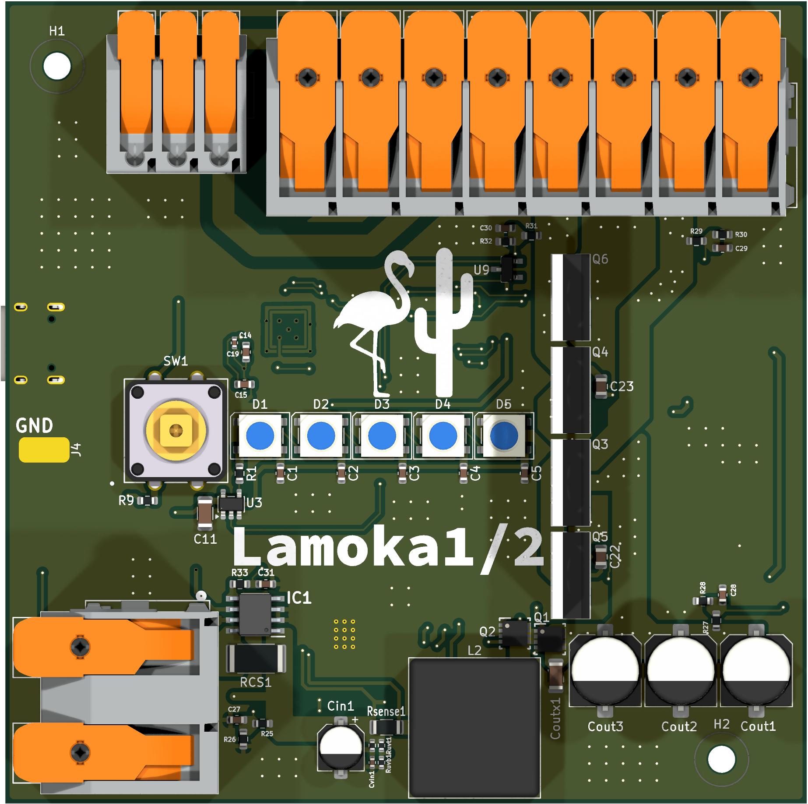
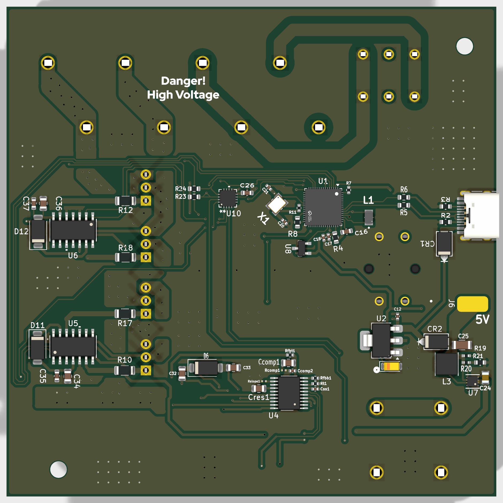
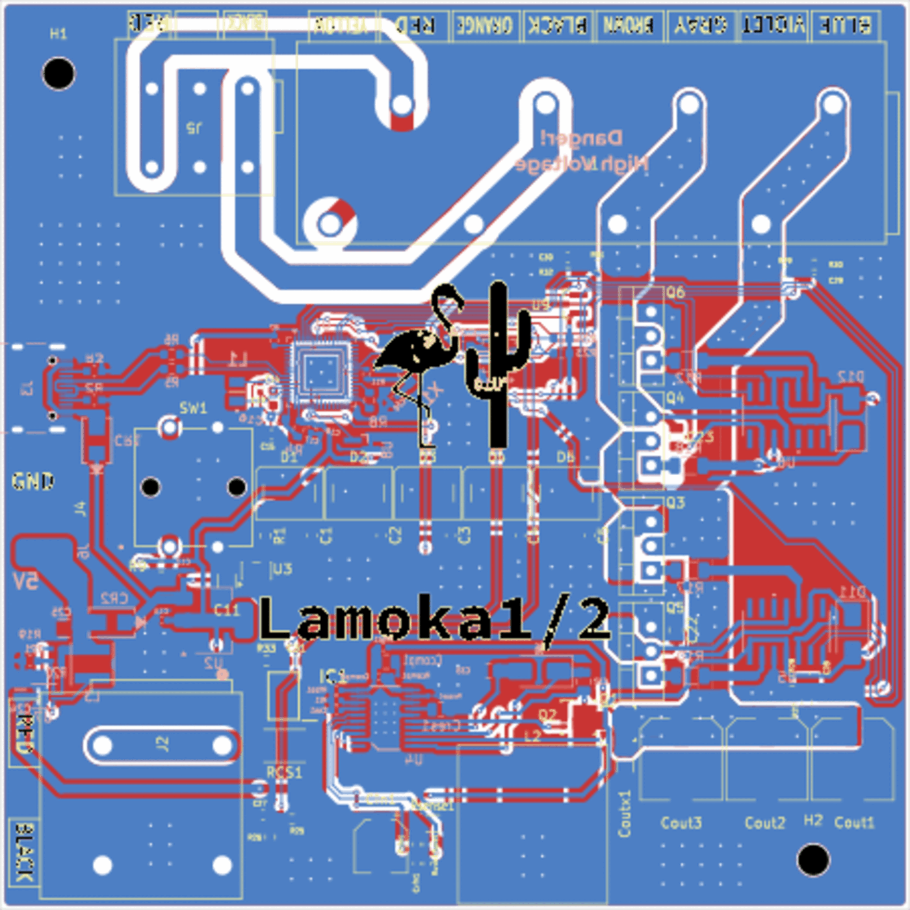

<div align="center">


<br>

<a href="https://www.bestpractices.dev/projects/14750">
  
</a>
&nbsp;&nbsp;
<a href="https://www.repo-grade.com/report/bearjhartjen/lamoka1-project">
  
</a>

</div>

---

## Owego Rotary craft fair

For the Owego Rotary craft fair, taking place at the Elks Lodge in Owego, NY, on November 14th from 9am to 3pm, the main project being presented by Flamingo and Cactus will be the Lamoka1/2, an inverter-only version of the Lamoka1. More details will be presented after the event.


## What is the Lamoka1?

The Lamoka1 is an open-source inverter/charger system designed for complete transparency and control. Unlike market alternatives that are locked-down black boxes, the Lamoka1 gives you full access to your power conversion. If you don't have technical experience, that's completely fine—our Portal Interface Engine (Lamoka's operating system) provides a solid stock setup. But if you want to get technical, feel free to customize and modify the unit however you like.

---

## Specifications

The Lamoka1 inverter section takes an 11V–14V input, steps it up to a 17V rail via an LM5122 boost converter, and feeds it into an H-bridge (four CSD19536KCS NMOSs driven by two UCC27735DR gate drivers) controlled by an RP2354A microcontroller—giving you total flexibility to program whatever waveform or output you need. From there, it passes into a VPT24-4170 transformer to step up the voltage.

We use a Qualtek FAD1-04010BHLW11 fan powered from the 5V buck rail for cooling. GPIO5 and GPIO6 are unused, so the MCU provides no PWM speed control or tach feedback for the fan. The two TMP235A2DBZR temperature sensors are monitored by the system. Voltage and current monitoring is handled by the ADS7128IRTER multiplexer, the 5V rail by the TPS62160DSGR buck converter, and the user interface by addressable WS2812B LEDs with a B3F-4055 button (five LEDs on the Lamoka1/2 main board; the DEV-Brain control board carries ten).

---

## Quick start

The repository is source-first: KiCad 10 projects, Arduino firmware, and design documents. You can open the design with nothing but KiCad installed, and build the firmware for the Lamoka1-DEV-Brain control board (PIE V1.8, bench-tested) or for the main board (PIE V1.9, which compiles clean but has never run on hardware).

```bash
# 1. Clone the repository
git clone https://github.com/bearjhartjen/Lamoka1-project.git
cd Lamoka1-project

# 2. Open the main board (inverter-only Lamoka1/2) in KiCad 10
#    (or open HARDWARE/Kicadfiles/Lamoka1-half/Lamoka1-half.kicad_pro from the KiCad GUI)
kicad "HARDWARE/Kicadfiles/Lamoka1-half/Lamoka1-half.kicad_pro"

# 3. Export a fabrication package for your own build
mkdir -p ~/lamoka-fab
kicad-cli pcb export gerbers --output ~/lamoka-fab/ "HARDWARE/Kicadfiles/Lamoka1-half/Lamoka1-half.kicad_pcb"
kicad-cli pcb export drill   --output ~/lamoka-fab/ "HARDWARE/Kicadfiles/Lamoka1-half/Lamoka1-half.kicad_pcb"
```

The repository also ships a [`Makefile`](Makefile) that wraps the common tasks
(`make help` lists them): `make firmware` builds the default PIE sketch (the
DEV-Brain head, V1.8 — pass `SKETCH=` for another revision, such as the main
board's V1.9), `make test` runs the repository checks, `make check` adds the KiCad
ERC and DRC reports, `make static` runs cppcheck over the firmware, and
`make lint` runs ruff over the Python tooling. The checks and the linter use
the pinned environment in [`pyproject.toml`](pyproject.toml) / `uv.lock`:
install [uv](https://docs.astral.sh/uv/) and run `uv sync` once.

The Portal Interface Engine (PIE) is the firmware line. Every revision is a separate sketch file, and there are two current heads: **V1.8** for the Lamoka1-DEV-Brain (ten LEDs and the single button, bench-tested) and **V1.9** for the Lamoka1/2 main board (five LEDs plus the power stage — explicit arming, PWM dead-time, soft start, closed-loop regulation, and supervisory protection). V1.9 compiles clean but has never run on hardware, and the power stage has never been energized:

```cpp
// SOFTWARE/Portal Interface Engine/V1.8.ino (excerpt) — targets the Lamoka1-DEV-Brain
#define LED_PIN    11   // WS2812B data
#define NUM_LEDS   10   // DEV-Brain fits ten LEDs (D1-D10)
#define BUTTON_PIN  0   // single-button UI, INPUT_PULLUP

CRGB leds[NUM_LEDS];

void setup() {
  FastLED.addLeds<WS2812B, LED_PIN, GRB>(leds, NUM_LEDS);
  // ...
}
```

One button drives the whole interface: tap to move, double-tap to go back, hold to select. The gesture map and UI behavior are described in [PIE-v1.8-information.md](SOFTWARE/Portal%20Interface%20Engine/PIE-v1.8-information.md) for the DEV-Brain and [PIE-v1.9-information.md](SOFTWARE/Portal%20Interface%20Engine/PIE-v1.9-information.md) for the main board. Flashing instructions are in [Build and fabrication](#build-and-fabrication).

---

## Hardware

| Board | What it is | State | Design files |
| --- | --- | --- | --- |
| **Lamoka1/2** (main) | Inverter board: 11–14V input, 17V boost, H-bridge, RP2354A, output transformer wired off-board | Laid out; power stage never energized | [`HARDWARE/Kicadfiles/Lamoka1-half/`](HARDWARE/Kicadfiles/Lamoka1-half) |
| **Lamoka1-DEV-Brain** | Control-only board (MCU, LEDs, button) used to develop the firmware | Built and assembled; 72-hour burn-in passed | [`Lamoka1-DEV-Brain/`](Lamoka1-DEV-Brain) |

<p align="center">
  
  
  <br><em>3D renders of the current layout — exported with <code>kicad-cli pcb render</code>.</em>
</p>

<p align="center">
  
  <br><em>Copper layers — F.Cu (red) and B.Cu (blue), plotted from the KiCad layout.</em>
</p>

Design documentation lives alongside the sources:

- [Design_Notes.md](HARDWARE/Design_Notes.md) — design intent, pin map, H-bridge and monitoring details.
- [COMPONENTS.md](HARDWARE/COMPONENTS.md) — plain-English component reference (not the BOM).
- [SOFTWARE/Operation.md](SOFTWARE/Operation.md) — intended boot sequence and behavior.
- [Lamoka1-DEV-Brain/Readme.md](Lamoka1-DEV-Brain/Readme.md) — the control board, its test results, and how to order it.
- [docs/README.md](docs/README.md) — documentation index for the whole project.

---

## Build and fabrication

> [!WARNING]
> The Lamoka1/2 produces mains voltage (120V AC, North American outlet). Treat the output as live at all times and never leave a powered unit unattended. The power stage has been laid out but has never been energized, and its control firmware (PIE V1.9) has never run on hardware — this revision is a development platform, not a finished product.

### 1. Order the PCB

The prepared package for this revision is committed under [`HARDWARE/Lamoka1-half fab files/`](HARDWARE/Lamoka1-half%20fab%20files/README.md); the notes below describe how it is produced and what to check when ordering. The board is **2 layers, 1.6 mm FR-4, 95.2 × 95.2 mm**, with 0.15 mm (5.9 mil) minimum tracks, 0.18 mm minimum clearance, 0.2032 mm minimum drills and 0.10 mm via annular rings. Check a fab against those four numbers rather than against a generic "6 mil" pitch: PCBWay's standard process covers all of them (the 4 mil rings fall in its "medium difficulty" class), while a house whose standard process stops at 0.3 mm drills would not.

```bash
# Gerbers, drill files and (optionally) a pick-and-place file
mkdir -p ~/lamoka-fab
kicad-cli pcb export gerbers --output ~/lamoka-fab/ "HARDWARE/Kicadfiles/Lamoka1-half/Lamoka1-half.kicad_pcb"
kicad-cli pcb export drill   --output ~/lamoka-fab/ "HARDWARE/Kicadfiles/Lamoka1-half/Lamoka1-half.kicad_pcb"
kicad-cli pcb export pos --format csv --units mm \
  --output ~/lamoka-fab/Lamoka1-pos.csv "HARDWARE/Kicadfiles/Lamoka1-half/Lamoka1-half.kicad_pcb"
```

In the KiCad GUI the same output is under **File → Fabrication Outputs → Gerbers / Drill Files**. Zip `~/lamoka-fab/` and upload it to your fab of choice. The DEV-Brain was manufactured and assembled by [PCBWay](https://www.pcbway.com/project/shareproject/Lamoka1_DEV_Brain_49e4fd0a.html); its fab files (including the exact package we ordered) are committed under `Lamoka1-DEV-Brain/Lamoka1-DEV-Brain fab files/` as a worked example, and the main board's equivalent is in [`HARDWARE/Lamoka1-half fab files/`](HARDWARE/Lamoka1-half%20fab%20files/README.md).

### 2. Order the parts

The bill of materials generated from the schematic is committed as [`HARDWARE/Kicadfiles/Lamoka1-half/Lamoka1-half.csv`](HARDWARE/Kicadfiles/Lamoka1-half/Lamoka1-half.csv). It carries Reference, Qty, Value, Footprint, MPN and Description columns — the Reference column is a grouped list, so one row can cover several parts — and it has no manufacturer column at all. The schematic remains authoritative. The orderable version, in PCBWay's 9-column format with manufacturer and description filled in for all 70 lines, is [`HARDWARE/Lamoka1-half fab files/Lamoka1-half BOM.csv`](HARDWARE/Lamoka1-half%20fab%20files/Lamoka1-half%20BOM.csv), built by [`tools/make_fab_bom.py`](tools/make_fab_bom.py) — rerun it after design changes. The large items (transformer, fan, outlet, Wago connectors) are listed in [COMPONENTS.md](HARDWARE/COMPONENTS.md); we sourced them from DigiKey.

Regenerate the BOM after design changes from the KiCad GUI (**Tools → Generate BOM**) or the command line:

```bash
kicad-cli sch export bom \
  --fields "Reference,QUANTITY,Value,Footprint,MPN,Description" \
  --labels "Reference,Qty,Value,Footprint,MPN,Description" \
  --group-by "Value,Footprint,MPN" \
  --output "HARDWARE/Kicadfiles/Lamoka1-half/Lamoka1-half.csv" \
  "HARDWARE/Kicadfiles/Lamoka1-half/Lamoka1-half.kicad_sch"
```

### 3. Assemble the board

SMD parts are fitted on both sides, so plan a two-pass reflow or use a stencil and a hot plate; then hand-solder the through-hole parts. Rough order of operations:

1. Stencil solder paste onto both sides (a thin 4 mil stencil works for the 0402/0603 parts).
2. Place the SMDs and reflow. Populate the front side first, then the back.
3. Hand-solder the through-hole parts: the Wago terminals (J1, J2, J5), the button (SW1), the USB-C shield tabs (J3), and the TO-220 H-bridge MOSFETs (Q3–Q6), which stand vertically along the board edge and can carry a heatsink. The four polymer capacitors (Cin1, Cout1–Cout3) are reflow parts that also tolerate a fine-tip iron, and the fan solders to two wire pads, J4 (GND) and J6 (5V), rather than to a header.
4. Check for solder bridges and shorts with a multimeter before applying power — especially on the 11–14V input and the 17V boost rail.

### 4. Bring-up

The transformer, DC input, and the AC outlet wire into the Wago connectors on the board edge (see [Design_Notes.md](HARDWARE/Design_Notes.md) and, for the transformer leads, [Transformer-wiring.md](HARDWARE/Transformer-wiring.md)). Bring-up is done in stages, and low-voltage checks come before anything touches the transformer:

1. **Visual + continuity check** — no short between the input rails and ground.
2. **USB-C only (5V)** — confirm the 3.3V and 1.1V rails come up. The buck runs from the 11–14V input, so on USB alone the 5V rail is fed from USB through the OR-ing diodes (CR1/CR2) and the buck stays off.
3. **11–14V from a current-limited bench supply** (start around half an amp) — confirm the 17V boost rail and check for abnormal current draw.
4. **Gate-drive check** — verify the UCC27735 outputs at the MOSFET gates before the transformer is connected.
5. **Transformer and output last** — connect the transformer and the outlet only after the low-voltage side checks out, and treat the output as live AC from that point on. The lead-to-terminal map is [`HARDWARE/Transformer-wiring.md`](HARDWARE/Transformer-wiring.md); read it first, because the `J1` net names are lead colours and this transformer's BLUE/BROWN leads are its 115 V winding, so the leads must not be fitted colour-for-colour.

> [!NOTE]
> PIE V1.9 is the first main-board firmware (arming, PWM dead-time, soft start, closed-loop regulation, supervisory protection) and compiles clean, but it has never run on hardware and the power stage has never been energized. Do not expect the board to produce output until the staged bring-up above and the firmware bench checks are complete.

### 5. Flash the firmware (Lamoka1-DEV-Brain)

PIE V1.8 runs on the DEV-Brain and is built with the [arduino-pico](https://github.com/earlephilhower/arduino-pico) core (RP2350 support) and the FastLED library. (The main board uses PIE V1.9 instead: `make firmware SKETCH="SOFTWARE/Portal Interface Engine/V1.9.ino"`. It has never been flashed to hardware, so treat the first flash as part of the staged bring-up.)

With the Arduino IDE:

1. Add `https://github.com/earlephilhower/arduino-pico/releases/download/global/package_rp2040_index.json` under **File → Preferences → Additional Boards Manager URLs**, then install the **Raspberry Pi Pico/RP2040/RP2350** core in Boards Manager.
2. Install **FastLED** from Library Manager.
3. Open [`SOFTWARE/Portal Interface Engine/V1.8.ino`](SOFTWARE/Portal%20Interface%20Engine/V1.8.ino), select your RP2350-family board (e.g. *Generic RP2350* for a bare RP2354A) and the board's USB port, and click **Upload**.

With `arduino-cli` — or `make upload PORT=/dev/ttyACM0`, which stages the
sketch and does both steps for you (copy [`.env.example`](.env.example) to
`.env` to keep the port, sketch, or board options locally):

```bash
arduino-cli core install rp2040:rp2040 \
  --additional-urls https://github.com/earlephilhower/arduino-pico/releases/download/global/package_rp2040_index.json
arduino-cli lib install FastLED

make firmware                    # compile the default revision (DEV-Brain head, V1.8)
make firmware SKETCH="SOFTWARE/Portal Interface Engine/V1.9.ino"   # compile the main-board head
make upload PORT=/dev/ttyACM0    # compile and flash
```

Arduino expects each sketch to live in a folder of the same name, and the PIE
revisions deliberately share one folder — `make firmware` copies the chosen
revision into its own folder under `build/` before compiling, so nothing has to
be renamed or moved by hand.

If the port does not appear, put the board into USB bootloader mode from the UI: **Settings → BOOTSEL**, which restarts the RP2354A into its boot ROM. There is no BOOTSEL button on the DEV-Brain, so this is the practical way in — otherwise you would have to hold the RP2354A's BOOTSEL pin low through a reset.

### 6. Mechanical models

Both KiCad layouts export to STEP models under [`HARDWARE/Mechanical/`](HARDWARE/Mechanical) — board outline, holes, and component bodies — for enclosure design and fit checks:

- [`Lamoka1-half.step`](HARDWARE/Mechanical/Lamoka1-half.step) — the Lamoka1/2 main board.
- [`Lamoka1-DEV-Brain.step`](HARDWARE/Mechanical/Lamoka1-DEV-Brain.step) — the DEV-Brain control board.

Regenerate them after layout changes with `make step`, or one at a time:

```bash
kicad-cli pcb export step \
  --output "HARDWARE/Mechanical/Lamoka1-half.step" "HARDWARE/Kicadfiles/Lamoka1-half/Lamoka1-half.kicad_pcb"
kicad-cli pcb export step \
  --output "HARDWARE/Mechanical/Lamoka1-DEV-Brain.step" "Lamoka1-DEV-Brain/Kicad files/Lamoka1-DEV-board.kicad_pcb"
```

Component bodies come from the vendor 3D models that the layouts reference; those files are not redistributed (see [License](#license)), so a fresh clone exports the bare board unless you supply your own copies.

---

## Firmware

The Portal Interface Engine (PIE) is Lamoka's operating-system firmware. It is a one-button LED interface (status ball, fireplace, lightsaber, rainbow, the Fireball game, settings, sleep, USB BOOTSEL) written as Arduino sketches with `#define` pin constants, FastLED for the LEDs, and `pico/bootrom.h` for bootloader entry. Each revision is a new file, and there are two current heads: **V1.8** for the Lamoka1-DEV-Brain and **V1.9**, the first main-board firmware, which adds the power stage (explicit arming, PWM dead-time, soft start, closed-loop regulation, supervisory protection) but has never run on hardware — see [SOFTWARE/README.md](SOFTWARE/README.md) for board compatibility, [PIE-v1.8-information.md](SOFTWARE/Portal%20Interface%20Engine/PIE-v1.8-information.md) and [PIE-v1.9-information.md](SOFTWARE/Portal%20Interface%20Engine/PIE-v1.9-information.md) for the full behavioral descriptions.

---

## Contributing

Contributions are welcome — hardware review, firmware, documentation, and testing all help. Start with [CONTRIBUTING.md](CONTRIBUTING.md) for the development setup, KiCad and firmware conventions, and the pull-request checklist, then use the issue templates to report bugs or request features. All participation is covered by our [Code of Conduct](CODE_OF_CONDUCT.md); security reports go through [SECURITY.md](SECURITY.md).

---

## License

- **Hardware** — CERN Open Hardware Licence v2, weakly reciprocal ([`LICENSE-HARD`](LICENSE-HARD); SPDX-named copy in [`LICENSES/CERN-OHL-W-2.0.txt`](LICENSES/CERN-OHL-W-2.0.txt)). You may build, modify, and sell units, provided modifications are shared back under the same licence.
- **Software** — GNU GPL v3.0 only ([`LICENSE-SOFT`](LICENSE-SOFT); SPDX-named copy in [`LICENSES/GPL-3.0-only.txt`](LICENSES/GPL-3.0-only.txt)). The firmware and tooling may be used, modified, and redistributed under the GPL; derivative software must remain GPL-3.0.
- Vendor datasheets and third-party 3D models are not redistributed here; download them from the manufacturer.

---

## Usage of AI in this repository


This repository is checked, maintained, and updated by humans. The Lamoka series is neither “vibe coded” nor blindly applied. Thought, testing, engineering judgment, and practical experience go into every decision made throughout the project.

AI is used as a tool to help us bridge the gap between our current resources and the scale of what we want to accomplish. It may assist with research, development, documentation, and other aspects of the project, but its output is not treated as inherently correct. Human review, testing, and engineering judgment remain essential to the development process.

PIE OS is an exception in that a significant portion of its code was generated with the assistance of AI. However, it has been reviewed, tested extensively, and refined to meet the same standards we apply to the rest of our work.

At Flamingo and Cactus, our goal is to provide the best products, services, and experiences we can to as many people as possible. As a small team, there are limits to what we can accomplish on our own. We have very large dreams, and AI allows us to act as a much larger team without losing the human judgment and responsibility behind what we create.
